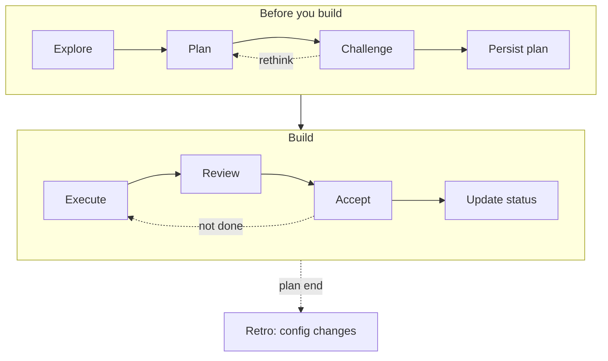
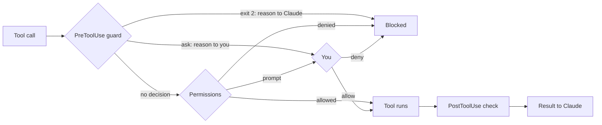
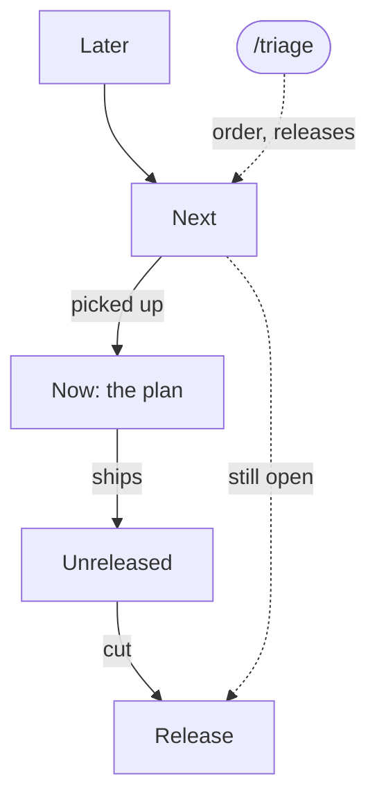

# Minnel: a file-first operating model for Claude Code

*A discipline for driving Claude Code, written for experienced solo developers and small teams. Last updated 2026-11-25.*

---

## Operating principle

This is an **operating model**: a file-first way of working you keep running, not a procedure you run once; "the methodology" is the shorthand used for it throughout.

The job is to engineer a repeatable environment around the model. The model's **attention** and its **context window** are the scarce resources. A good methodology is therefore mostly a set of decisions about two things:

1. **What you persist to files** — so intent survives compaction, session restarts, and your own forgetfulness.
2. **What you enforce deterministically** — so correctness does not depend on the model remembering a rule.

Everything below follows from that. The second point matters most when nothing else checks the work. Without a CI pipeline or a second reviewer, hooks and a review subagent are the checks you have. With CI, hooks move some of those checks to the moment of the edit, where the agent can still act on them.

> **Versioning note.** Claude Code's surface moves quickly and several features below are version-gated (forks, nested subagents, the `opusplan` setting, `.claude/rules/`). Confirm against your installed version with `claude --version` and the `/help` and `/hooks` menus before relying on any specific mechanic.

---

## 1. Context architecture: what lives where

The governing distinction is **always-loaded vs loaded-on-demand**. `CLAUDE.md` is injected into context on every turn, so it is expensive real estate. Detailed material (architecture, plans, design decisions, and conditional rules) belongs in files under `docs/` and in path-scoped `.claude/rules/`, which load only when relevant.

| Layer | File(s) | Loading | What belongs here |
|---|---|---|---|
| Global rules | `~/.claude/CLAUDE.md` (+ `~/.claude/rules/*.md`) | At launch, all projects. A user rule with `paths` loads like a `.claude/rules/` file (two rows down); one without loads at launch (observed, v2.1.273). User rules load before the project's `.claude/rules/`, and neither overrides the other | Personal conventions: language/spelling, tone, commit style, "ask before X", default tooling. One rules file per convention (commit style, dates, private notes) is easier to share or replace than one long file |
| Project rules + invariants | `./CLAUDE.md` (+ any in parent directories, and nested `./module/CLAUDE.md`) | At launch; a nested file once Claude reads, writes or edits a file in its subdirectory | Hard constraints/invariants, build/test commands, where the active-plan pointer lives (§3), links into `docs/`. The files are concatenated, and none overrides another; parent files run from the root down, so the one nearest the working directory is read last. Keep it lean |
| Path-specific / conditional rules | `.claude/rules/*.md` | With `paths` frontmatter, when Claude reads, writes or edits a matching file; without it, at launch | With `paths`, anything that applies to *some* of the tree, not all of it. Without, a standing checklist such as the Definition of Done, which then costs the same as `CLAUDE.md` because it loads every session |
| Architecture (explanatory) | `docs/architecture.md` | On demand (linked; read when relevant) | Component breakdown, diagrams, data model, rationale: everything that is *not* a must-obey constraint |
| Design decisions | `docs/design/*.md` (ADRs) | On demand | Architecturally significant, costly-to-reverse decisions and their reasoning |
| Plans (status folded in) | `docs/plans/<name>.md` | On demand, stage-granular | Detailed, multi-stage plan; its status lives in the same file (see §3) |
| Skills (procedural) | `.claude/skills/<name>/SKILL.md` | On demand (model- or `/`-invoked) | A reusable *procedure*: how to do a recurring task; the body loads only when invoked (see §10) |
| Agent / persistent memory | `.claude/agent-memory/<agent>/` for `project` scope (or the `user`/`local` equivalent set by the subagent `memory:` field) | Recalled when relevant | Durable, hard-won learnings to carry across sessions, *not* facts the repo, git history, or `CLAUDE.md` already record |

**No automatic precedence between scopes.** Claude Code concatenates the memory files it loads ([memory docs](https://code.claude.com/docs/en/memory)): managed policy, user `~/.claude/CLAUDE.md`, project `./CLAUDE.md`, local `CLAUDE.local.md`, broadest first. None overrides another, and conflicts are *not* resolved by scope: if a user rule and a project rule contradict, the model may follow either, and a project rule sitting later in context does not make it win. So keep the two consistent. Where a project must override a personal default, say a different tone or commit style, state that override explicitly in the project file. Don't lean on load order, and don't leave a bare contradiction for the engine to settle. (Path-scoped `.claude/rules/` behave the same way: they load when a matching file is touched but carry no precedence over `CLAUDE.md`.)

**Keep `CLAUDE.md` lean and stable.** The common failure is letting it accrete into a several-hundred-line dumping ground. Once it is long, two bad things happen: you pay context tax on every turn for rules that rarely fire, and the model deprioritises earlier system-level instructions in long sessions. A useful test: *if a rule would not apply to most turns, it does not belong in `CLAUDE.md`*. Move it to a path-scoped `.claude/rules/` file or a doc under `docs/`. [Official cost guidance](https://code.claude.com/docs/en/costs) agrees: move instructions from `CLAUDE.md` to skills, and offload processing to hooks.

**Split the architecture document out, but not the invariants with it.** A large architecture document has no business loading on every turn, so the explanatory bulk (components, diagrams, rationale) belongs in `docs/architecture.md`, referenced from `CLAUDE.md`. The trap: `CLAUDE.md` is *guaranteed* in context, whereas a linked doc is read only if Claude opens it. So the *hard constraints* (the rules that must hold on every change) have to stay as a short "Invariants" block in `CLAUDE.md`; a constraint sitting solely behind a link is one Claude will eventually violate because it never read the file. The line to cut along is "rules that must always be obeyed" (`CLAUDE.md`) versus "background consulted when relevant" (`docs/`). One caveat on mechanism: importing a file into `CLAUDE.md` (the `@`-style import) pulls its *full* content into the always-loaded path, reintroducing the cost you are avoiding. For a large doc, use a plain path reference Claude reads on demand, not an import. Confirm import-vs-reference behaviour in your installed version.

**Keep a Working agreement in `CLAUDE.md`.** Alongside the invariants, the project `CLAUDE.md` carries a short *Working agreement*: the how-we-work rules (plan discipline, review-before-merge, verify-don't-assume) that the sections below justify. Cross-project rules that hold regardless of the repo (worktree hygiene, verify-before-asserting) belong in `~/.claude/CLAUDE.md` or a file under `~/.claude/rules/`; project-bound rules that name this repo's commands, branches, or subagents stay in the project file. The canonical text is in the template ([`templates/CLAUDE.template.md`](https://github.com/minnelhq/minnel/blob/main/templates/CLAUDE.template.md)); this document explains those rules in the sections that follow rather than reproducing them, so the agreement has one source of truth, not three.

**Treat the memory directory like `CLAUDE.md`, not a journal.** Agent memory (the `memory:` scope, §4) is real persistence, so it earns the same discipline as every layer above: write only the non-obvious, one fact per entry, and don't store what the repo, git history, or `CLAUDE.md` already record. Two hazards are specific to it. A *stale* recalled memory is worse than `CLAUDE.md` drift. It surfaces as authoritative background you may not think to question, so prune on contradiction, and re-verify any memory that names a file, flag, or version before acting on it. And recall is itself a context cost, so a speculative pile of memories taxes every session that triggers them. Pruning happens at the retro (§8), which proposes deleting, merging or rewriting stale and duplicated entries in memory and the rule files alike. A reviewer that keeps memory also prunes as it goes: when a finding contradicts one of its notes, it updates or deletes the note (Appendix A).

**The tool surface is context too.** Every connected MCP server puts its tool definitions into the same scarce window as `CLAUDE.md`. A chatty server's schemas can rival a long instructions file. The scarcity logic from the file layers carries over unchanged: most tools won't fire on most turns, so they shouldn't sit in context up front. Claude Code now does this for you: **Tool Search** is on by default, deferring each server's full schemas and loading only tool *names* until Claude reaches for one. Tune it with `ENABLE_TOOL_SEARCH`. `auto:N` defers only once the combined tool definitions across all servers would exceed N% of the window, and `false` turns deferral off. To load one server eagerly again, set `alwaysLoad: true` on it in `.mcp.json`. Two caveats. Deferral needs a model that supports tool-reference lookups, so a Haiku-backed agent (Explore, §4) falls back to loading everything. And deferral shrinks the *resting* cost, not the *catalogue*. A server you never use is better disabled (`disabledMcpjsonServers`, or left unconnected) than deferred. That last point is also least privilege: the narrowest tool surface is both the cheapest context and the smallest attack surface (§11), and `mcp__<server>__<tool>` allow/deny rules in `settings.json` narrow what a connected server can actually do.

**One subtlety.** The built-in **Explore** and **Plan** subagents deliberately skip your `CLAUDE.md` and git status to stay fast and cheap. So a rule that *must* reach exploration ("ignore `vendor/`") has to be restated in the delegating prompt, not merely parked in `CLAUDE.md`.

---

## 2. The core loop

| Stage | Mechanism |
|---|---|
| Explore | Plan mode (read-only), or let Claude delegate to the read-only **Explore** agent (Haiku) |
| Plan | Still in plan mode; research via the **Plan** subagent; plan presented through the exit-plan tool. Nothing is written until you approve. Codify as `/plan` (Appendix J) |
| Challenge | Adversarial pass *before* you commit to the plan: cast Claude as a sceptic ("what's this missing? why might it not be worth doing?"). The cheap synthesis of the role tension you lose solo (see §8) |
| Persist | Write the approved plan to `docs/plans/<name>.md` *before* execution (see §3) |
| Execute | Drop to an edit-capable mode on a feature branch or worktree |
| Review | Your `code-reviewer` subagent (§4), once on the branch's final diff before merge (§7), not after every task |
| Accept | Deliberately check the increment against the Definition of Done (see §8) before calling it done; the agent will not do this for you. Codify as `/accept` (Appendix K) |
| Update status | Advance the current stage and record outcome/decisions in the same plan file |

**Plan only when the task merits it.** A one-line fix does not need a plan-mode round trip. That is ceremony. Plan first when the approach isn't obvious: a refactor, an architectural choice, or anything touching an invariant you cannot afford to get wrong. Work that merely spans a few files but is mechanically clear does not need one, and below that bar plan mode is friction. You can set plan mode as the session default and step out of it deliberately, or use it ad hoc. The **Challenge** and **Accept** stages scale the same way: skip them for trivial work, apply them whenever scope or quality is in question. **Review** runs at a coarser grain: once per branch, on the final diff before merge. On a branch that carries several tasks, Accept on the earlier ones reports the review as pending, and the review runs on the last, before its Accept.

The loop above is the per-task rhythm. When a plan is finished, run a **retro** that turns recurring friction into configuration and proposes what to prune (§8). That is the one cadence worth keeping, and it is event-driven, not calendar-driven.

*See [a worked example](worked-example.md) for this loop traced end to end through one real change.*

---

## 3. Plans, with status folded in

This is the highest-leverage habit and the one most people skip. Both the main conversation and subagent transcripts compact; sessions restart. If the plan lives only in the conversation, a compaction event can silently drop the half of it the model still needed.

Each non-trivial task gets one file under `docs/plans/`, structured as a sequence of **Stages** worked through in order. Status is folded into that same file rather than split into a separate `STATUS.md`: the current-stage marker, the per-step checkboxes, recorded deviations, and the decision log all live where the work they describe is defined. One file, one source of truth, which removes the classic failure where a separate status file drifts out of step with the plan it is meant to track.

Three things keep this working at scale:

1. **Write the plan before executing.** After plan-mode approval, Claude writes the file — goal, stages, per-stage steps with acceptance criteria, explicit out-of-scope notes.
2. **Load by stage, not whole-file.** A large multi-stage plan reloaded in full on every turn is its own context tax. Structure it so the active stage can be read on its own, and point Claude at that stage during execution rather than the entire document.
3. **Keep one pointer to the active plan, in one place.** A single line names which plan is live. It can sit in a section of your backlog, a `docs/plans/README.md` or `CLAUDE.md`; pick one and say in `CLAUDE.md` which. If you keep a backlog (§8), its Now section is the default: `CLAUDE.md` then holds a fixed line that never changes, and the backlog's Now item names the plan. Without a backlog, `CLAUDE.md`'s "Active plan" line names the plan file itself, at the cost of editing an always-loaded file each time a plan starts or ends. Either way the pointer names the file, not the stage: the plan's status line carries the stage, and a copy would go stale. This is the one job the old separate status file did well: giving a cold-start session somewhere to land so it resumes the right plan rather than guessing.

The payoff is that recovery from a compaction or a fresh session becomes "read the active plan, continue from the current stage" rather than reconstructing intent from a degraded transcript. For a solo workflow with no ticketing system, these plan files *are* your project memory; keep them in the repo so they version alongside the code they describe. When a plan is done, move it to `docs/plans/archive/` and clear the active-plan pointer: completed plans stay versioned as history without crowding the active set a cold-start session has to scan. `/wrap` (Appendix N) does this once the last stage has passed the Definition of Done, bar items pending until merge such as the review.

A complementary deterministic safeguard: a `PreCompact` hook can re-inject the active stage, and a `PostCompact` hook can confirm it was reloaded, so persistence does not depend on the model choosing to re-read the file.

---

## 4. Subagent roster

The temptation is to build a zoo. Resist it. The built-ins already cover most delegation, and every custom subagent is another `description` Claude must reason about when deciding where to route. Build a custom subagent only when you keep spawning the same worker, with the same instructions and the same tool restrictions.

### Built-ins worth knowing

| Agent | Model | Tools | Role |
|---|---|---|---|
| Explore | Haiku | Read-only | Fast file discovery and code search; keeps verbose output out of main context |
| Plan | Inherits | Read-only | Codebase research during plan mode |
| general-purpose | Inherits | All | Multi-step work needing both exploration and modification |

### Custom set for a solo workflow

| Subagent | Tools | Model | Why it earns its place |
|---|---|---|---|
| `code-reviewer` | `Read, Grep, Glob, Bash`, plus the Write and Edit that `memory` turns on | `inherit` | Told to report and not fix, so it doesn't "helpfully" rewrite while reviewing. Only the prompt holds it to that: `memory` lets it write its notes, and `Bash` can write any file. With no PR reviewer, this is your second pair of eyes; on model choice, see the note below |
| `test-writer` | `Read, Edit, Write, Bash` | `sonnet` | Needs write access; scope it to test directories with a `PreToolUse` guard if you want belt-and-braces |
| `db-reader` *(optional)* | `Bash` + `PreToolUse` validator | `haiku` | Only if you have a recurring need to run guarded read-only queries |

### Frontmatter essentials

Only `name` and `description` are required. The most common mistake is writing the markdown body as a user prompt. It is the system prompt. Beyond `tools`/`model`, the fields that matter for this methodology:

- `disallowedTools` — a denylist; often cleaner than an allowlist when you want "everything except Write/Edit".
- `permissionMode` — `default`, `acceptEdits`, `auto`, `dontAsk`, `bypassPermissions`, or `plan`.
- `memory` — `user`, `project`, or `local`; a persistent learnings directory. `project` is the sensible default so review patterns version with the repo. Setting it turns on Read, Write and Edit so the agent can keep its notes, whatever `tools` lists. With auto memory off, the field does nothing.
- `effort` — `low`, `medium`, `high`, `xhigh`, `max` (availability depends on model).
- `isolation: worktree` — runs the subagent in an isolated copy of the repo, auto-discarded if it makes no changes.

**A recommendation that diverges from common advice:** default your custom agents to `model: inherit` and only pin a model where the task has a clear cost/capability shape (Haiku for mechanical search, Sonnet for analysis). Pinning Opus on a reviewer that runs on every branch is a quiet money sink on a solo project. For the *sole* reviewer, `inherit` also has a quality argument: it makes the review exactly as capable as whatever produced the diff, so your one gate can never silently fall *below* the generator. It has two limits. It cannot rise *above* a cheap generator, and a same-model reviewer shares the author's blind spots. So pin a stronger or different model (or set `CLAUDE_CODE_SUBAGENT_MODEL` for one run) only when you want the review to exceed or diverge from the generator, as on a high-risk diff written on a cheaper model.

See Appendix A and B for drop-in definitions.

---

## 5. Model / mode decision matrix

Current aliases: `opus`, `sonnet`, `haiku`, plus `fable`. You can also pass a full ID such as `claude-opus-5-5` or `claude-sonnet-5-5`. Effort runs `low → medium → high → xhigh → max`. Permission modes: `default`, `acceptEdits`, `auto`, `dontAsk`, `bypassPermissions`, `plan`.

| Task | Model | Effort | Permission mode | Plan first? |
|---|---|---|---|---|
| Architecture / data-model design | `opus` | high–xhigh | `plan` | Yes |
| Gnarly debugging, root-cause hunt | `opus` | high | `plan` → `default` | Usually |
| Default feature work (the workhorse) | `sonnet` | medium | `default`, or `acceptEdits` on a branch | Only for a refactor or unclear approach |
| Mechanical refactor in a known area | `sonnet` | medium | `acceptEdits` (branch/worktree) | No |
| Codebase exploration / search | `haiku` (Explore) | low | `plan` (read-only) | n/a |
| Test writing | `sonnet` | medium | `default` | No |
| Docs / comments / renames | `haiku` | low | `acceptEdits` | No |

**Two opinions.**

- Set the **`opusplan`** model option as your default. It spends the expensive model precisely where reasoning pays off (planning) and drops to the workhorse for execution, with no manual switching. For a cost-conscious solo developer that is close to the right policy out of the box.
- **Avoid `bypassPermissions` as a habit.** It skips prompts and will happily write to protected paths (`.git`, `.claude`, and so on). The disciplined position is `acceptEdits` on a feature branch or in a worktree: you get flow without the foot-gun, and a bad run is one `git restore` (or one checkpoint rewind) away. (For the fuller stance, see §11: least privilege, sandboxing, the guards.)

---

## 6. Hooks: checks at the moment of the edit

Hooks are where determinism lives inside the session. The model can forget; an exit-code-2 hook cannot. Without a pipeline, they are your only automatic gate. With one, they catch some of the same failures earlier, and CI stays the authority: it runs on every push, including changes made outside Claude Code or in a session without the hooks. Three tiers:

- **`PreToolUse` guards** — the generalised version of a path/command guard. The hook reads the tool input as JSON on stdin, inspects it, and exits `2` to block, feeding the message on stderr back to Claude. For a step you want to approve rather than forbid, it can instead ask: exit 0 with a `permissionDecision` of `"ask"` in its JSON output, and you get a permission prompt showing its reason ([hooks docs](https://code.claude.com/docs/en/hooks)). Natural matchers: `Bash` (block destructive commands, enforce read-only SQL) and `Edit|Write` (protect paths outside the working area). A guard like this catches the slips that matter, which is what makes `acceptEdits` reasonable. One that reads a command as text is a tripwire, not a sandbox: it stops an agent's slip, not a command built to get past it.
- **`PostToolUse`** — matcher `Edit|Write`: run formatter/linter, and a quick build or targeted test. Catches breakage at the moment of edit rather than three steps later. Can run async so it does not block the turn.
- **Session/lifecycle hooks** — `SessionStart` for environment setup; `PreCompact`/`PostCompact` to protect and reload plan context; `SubagentStop` if you want an audit log of delegated work.

One tool call meets the first two tiers in turn:

Hooks can also be scoped *inside* a subagent's frontmatter (they fire only while that agent runs and are cleaned up afterwards). This is the clean way to make `test-writer` physically unable to write outside `Tests/`, regardless of what it is asked. Use the `$CLAUDE_PROJECT_DIR` prefix for hook script paths so they resolve regardless of working directory, and quote it (`"$CLAUDE_PROJECT_DIR"/.claude/hooks/bash-guard.sh`) so a project path with a space still runs. See Appendix C.

A Claude Code hook sees only Claude's tool calls. A convention that people follow too, such as the commit style, needs a git hook as well, because git runs it on each `git commit` in a clone where it is installed, whoever runs it. Appendix Q is a `commit-msg` hook that checks the subject against the commit style and, unless the project turns the check off, that a `feat` or `fix` commit adds its changelog line (§8). It is a tripwire like the guards: `git commit --no-verify` skips it, and CI stays the check nobody skips.

---

## 7. Solo-developer discipline

A few things that matter more when few people, or none, check your work:

- **One concern per branch or worktree.** `isolation: worktree` gives a subagent an isolated checkout that is auto-discarded if it makes no changes. Use it to try an approach without polluting your working tree.
- **Commit at every green checkpoint**, prompted by the `PostToolUse` test hook passing. Your undo granularity is your safety net. Checkpoints/rewind cover in-session mistakes; commits cover the rest. They are complements, not substitutes.
- **Treat `CLAUDE.md` and the memory directory as a living spec, not an archive.** Prune stale rules and contradicted memories; a contradicted instruction is worse than a missing one (memory hygiene: §1). The retro proposes the prunings at each plan boundary (§8), and the review subagent rewrites or deletes a note of its own when a finding contradicts it.
- **Run the review subagent on every branch that isn't trivial.** Without a PR reviewer it is your only second reader. With one, it runs first, so the person reads a diff already checked against the project's invariants and Definition of Done. Run it once on the branch's final diff before every merge to your main branch, except on branches your working agreement names as trivial in advance, such as typo fixes in prose. Run it again after you fix a Critical finding, after a Warning fix that changes code or published docs, or when the branch gains commits beyond fixes for its findings and the reviewer's own memory, and point the re-run at the new commits. A review covers only the diff it read, and a re-run needs to read only what changed since. Check any other fix against its finding yourself. Running it after every edit adds cost without catching more, since the final diff holds every edit.
- **Give Claude something to verify against.** A failing test, a type checker, a build command in `CLAUDE.md`. Verification loops are what turn "looks right" into "is right".

---

## 8. Solo product discipline

The product-owner and scrum-master roles don't vanish when you work alone; they relocate. The test for any scrum activity: does it coordinate *multiple humans* (drop it) or *manage scope, uncertainty, and quality* (keep it; those survive a team of one)? PO activities become persisted decision artefacts; SM activities become the work of tuning your human-agent operating system. One reframe: the "team" whose blockers you clear is partly **Claude**.

Four things are worth folding in. Everything else (standups on a cadence, story points, velocity, burndown) is coordination machinery you no longer need, and re-adding it as solo ritual is negative-value busywork.

**Definition of Done: the highest-value import, and it matters *more* with an agent.** Claude declares victory the instant something builds unless the bar is pinned down; this is the verification-loop principle wearing a scrum hat. Keep a project-wide DoD in `.claude/rules/` (Appendix E) and per-stage acceptance criteria in the plan file, so the **Accept** stage checks against an explicit list rather than a vibe.

**A backlog as a persisted, ordered file.** The value is the externalised queue, not the ceremony: priorities out of your head, and a place to point the agent at "the next thing". Keep `docs/backlog.md` (Appendix F): each item tagged type/value/effort with a one-line *why now*. Keep the prioritisation *thinking*; drop the estimation theatre.

**Order the backlog Now, Next, Later, and promise releases only for Next.** The sections follow the Now–Next–Later roadmap [Janna Bastow devised at ProdPad](https://www.prodpad.com/blog/invented-now-next-later-roadmap/). Now is the active plan. Next is ordered and expected. Later is deliberately undated, because the far end of a backlog can't keep promises. Next may group its items under a heading for the release they are meant for (`### X.Y.Z`), earliest first, with the rest under `### Unscheduled`; Later is never grouped by release. Grouped that way, the backlog is the roadmap, and anyone reading the repository sees it. It is the only record of which release each item is meant for, so there is no second copy to drift. The type tags of a version's items suggest the size of that release. Conventional Commits ties a `feat` to a minor version and a `fix` to a patch, and gives other types no effect on the version. A `debt` or `chore` item needs no release of its own unless an installer would notice it. A shipped item's line is deleted, so the check runs the other way: when you cut a version, `/release` (Appendix M) lists any item still under its heading and proposes finishing the item, moving it to a later release or to Unscheduled, or deleting its line if it has already shipped. Keeping the backlog current is its own ritual: `/triage` (Appendix P) flags items that have shipped or gone stale and drafts a new order and grouping for Next. `/triage` ends by showing the roadmap in the chat, with the active plan under Now and any private items your local notes hold.

**Backlog, plan, and changelog are one lifecycle.** The same unit of work moves through three views: a backlog item (a candidate: *what might happen*), pulled into a plan (committed: *what's happening*, §3), and on completion recorded in the changelog (shipped: *what happened*, user-facing). Tag backlog items by type (`feat`/`fix`/`debt`/`chore`) so they pre-sort into changelog categories; when an item ships, its user-facing outcome lands in the changelog and the backlog line is removed. This closes the loop the methodology otherwise leaves open. It had a record of future and present work, but none of the past.

The dotted edges are rituals that read the backlog: `/triage` orders Next and groups it by release, and `/release` lists any item still under the heading of the version being cut.

**The changelog is a curated human artefact, not a generated one.** Name its format, and the commit style its entries are drafted from, in your conventions: the project's `CLAUDE.md` or `.claude/rules/`, or, for a default across projects, `~/.claude/CLAUDE.md` or `~/.claude/rules/` (§1). The recommended default is Keep a Changelog: categories Added/Changed/Deprecated/Removed/Fixed/Security, an `## [Unreleased]` section on top, and SemVer versions below with ISO dates (Appendix H). Keep `CHANGELOG.md` at the repo root, the one deliberate exception to the `docs/` rule, because tools and readers expect it there and a visible changelog signals a maintained project (which matters when you distribute the plugin). Don't auto-generate it from `git log`. At release time, have Claude draft Unreleased entries from the finished plan and its commits, then curate. The `/release` command (Appendix M) reads both and falls back to Keep a Changelog or Conventional Commits for whichever is left unnamed. To have each `feat` or `fix` commit carry its own changelog line, so nothing waits for the release, install the `commit-msg` hook (Appendix Q): it refuses such a commit when it adds nothing under Unreleased. Keep it distinct from its neighbours: the changelog says *what changed, user-facing*; the plan's decision log says *why, internally*; an ADR says *which architectural choice, and its consequences*. The rule of thumb: if a user or installer would care, it's a changelog line; if only a future maintainer would, it isn't.

**Close a release with a tag, and a published release where the host has them.** Once the release commit is on the main branch, tag the commit that put it there (for a pull request, the merge or squash commit it made), `vX.Y.Z` unless your conventions name another format. The next `/release` reads the commits since that tag. Where the host publishes releases (GitHub, GitLab and Gitea do), publish one from the pushed tag with the version's changelog section as its notes, so people watching the repository hear of it. Pushing the tag and publishing the release change shared state, so they have one owner who confirms them with the user (§9). Run `/release <version>` again once the release is merged and it proposes both.

**The retro is the one ceremony that pays for itself, because here the process *is* the product you're tuning.** Every time you correct Claude twice for the same thing, that's a defect ticket against your configuration. The output is concrete: a `CLAUDE.md` line, a `.claude/rules/` entry, a hook, a subagent. Configuration that only grows turns into the dumping ground §1 warns about, so the retro also prunes. It lists the rules and memories the finished plan made obsolete, those that repeat each other or the Definition of Done, those naming a file, flag or version that no longer holds, and those that contradict another scope (§1). For each it proposes a delete, a merge or a rewrite. A read-only script starts the sweep with each file's length and the paths it names that no longer exist. It runs only when the retro calls it, not at session start, so it adds no context to other sessions. Claude Code's own [`/doctor prompt-audit`](https://code.claude.com/docs/en/memory) (v2.1.283 or later) checks the instruction files for dead references and contradictions in the same propose-only way. Its documented scope leaves out agent memory, and it can't know what the finished plan retired. Run the retro at plan boundaries, not on a calendar.

**Impediment removal becomes context engineering, and the lost role tension can be bought back.** An agent's blockers are removable: missing context (→ the plan, an architecture doc, a `CLAUDE.md` gap), missing tools (→ an MCP server or permission rule), ambiguous spec (→ tighter acceptance criteria). The genuine *loss* solo is independence: you're both judge and advocate. That's when the magpie problem bites, the interesting refactor over the valuable feature. Buy the missing seat back by casting Claude as sceptic at the **Challenge** stage: "argue this isn't worth building", "find the holes in these criteria".

The footprint is small by design: two artefacts (`docs/backlog.md` and a root `CHANGELOG.md`), one rules file (the DoD), and two habits already wired into §2's loop. Anything heavier rebuilds the ceremony you were right to leave behind.

---

## 9. Sessions, concurrency and git hygiene

One rule prevents most of the trouble: **one session, one worktree**. Never run two sessions in the same working directory. Git's working tree and index are shared mutable state, so two Claude sessions (or a session and you) in one checkout race on that state. One overwrites the other's edits, a session reads a file the other is mid-changing, or an over-eager `git add -A` sweeps up another session's half-written work.

Isolate with git worktrees. The CLI's `claude -w <branch>` (or `--worktree`) creates a linked worktree on its own branch and scopes the session to it; in-session, "work in a worktree" invokes the `EnterWorktree` tool. The desktop app creates a worktree only when its Worktree option is on, which is off by default, so check where a session is rather than assume: `pwd` in that session shows its checkout. The CLI does not do it by default, which is where people get caught. For subagents, `isolation: worktree` gives the same per-dispatch guarantee. Add `.claude/worktrees/` to `.gitignore` so worktrees don't show up as untracked files in your main checkout.

Gitignored files (your `.env`, your local notes) won't exist in a fresh worktree until you copy them in. A `.worktreeinclude` at the repository root lists them in `.gitignore` syntax, and Claude Code copies each match that git ignores into every worktree it creates. The copy happens once, when the worktree is created, so a later edit in either place doesn't reach the other. Make lasting edits in the main checkout, or copy a worktree's edits back before you remove it: removing the worktree discards them. A listed folder that is a git repository of its own isn't copied at all (observed, v2.1.330). Symlink it into each worktree from the main checkout instead, for example from a `SessionStart` hook. Ignore it with a pattern that has no trailing slash (`notes`, not `notes/`): a trailing slash matches only directories, so git would show the link as untracked. If the `.worktreeinclude` would name a path you keep private, leave it untracked and list it in `.git/info/exclude`: Claude Code still reads it (observed, v2.1.330).

Two boundary rules stop parallel work turning into merge conflicts. Scope worktrees by module, not by task, so two sessions cannot edit the same file. And rebase between them rather than merge. Tasks in the same module share one worktree sequentially; only cross-module work goes parallel.

**If sessions already share a checkout,** stop before anything is committed. `git worktree list` shows which branch each checkout holds, but two sessions in one checkout appear as one entry, so ask each session for its `pwd`. `git status` shows changes you did not make. Do not commit, switch branches or stage in a checkout another session is using. To move one session's work out, create the worktree with `git worktree add -b <branch> .claude/worktrees/<name>`, copy the changed files into it, compare each with `cmp -s` (or `diff -r` for a directory), commit there, and only then `git restore` the shared checkout. `git restore` discards the originals, so run it only after the comparison passes. Each step needs approval as §11 describes.

**One owner for shared state.** Pushes, force-pushes, tags and releases change state that other sessions and open pull requests depend on. Give each one a single owner, and have that owner confirm the step with the user in their own session before running it. Check the remote (`git ls-remote origin`) before reporting whether a push happened.

Two safeguards, both reusing machinery already in the methodology:

- A **`git` `PreToolUse` guard** (Appendix C) that blocks blanket staging (`git add -A`, `git add .`, `git add -u`) and `git commit -a`, and asks you to approve each `git push`: the §6 hook pattern pointed at the accidental-commit class. It lets an explicit `git commit` through, since a commit stays local until it is pushed and you commit at every green checkpoint (§7). The plugin's guards take per-project settings: staging, commits and pushes can each be set to allow, ask or block, and so can the bash guard ([Minnel as a plugin](plugin.md) lists the settings). The guard reads the command as text, so it catches a slip, not a push hidden in a variable or `sh -c`. Pair it with `.gitignore` discipline and the built-in `/security-review` command for credential leaks (secret hygiene is part of the security stance, §11).
- **Real commits, not checkpoints, as the source of truth.** Claude's rewind/checkpoints don't track bash-driven or *external* changes and aren't a version-control replacement, so in any concurrent setup they will desync. Commit at each green checkpoint and treat rewind as in-session only.

**Session close-out.** A session is ephemeral scratch; the files are the source of truth (§3). So the end-of-session ritual's first job is to guarantee the file-truth is current, with the summary and name as byproducts. Run a `/wrap` (Appendix N). It confirms the durable records are updated: plan status advanced, user-facing changes drafted into `CHANGELOG` Unreleased, decisions logged. When the plan's last stage has passed the Definition of Done (bar items pending until merge), it closes the plan: status set to done, pointer cleared, file archived (§3). It captures any retro signal (anything corrected twice becomes a config change, §8). Then it writes a one-line *pointer* summary naming which artefacts were touched and where things landed, and suggests a name. Keep the summary pointer-shaped: a verbose session summary becomes a fourth record that duplicates the plan, changelog and decision log, and a record that drifts is worse than none.

Name sessions to mirror their plan, so the two cross-reference: a session working `docs/plans/add-importer.md` is named `add-importer`, date-prefixed (`2026-06-18-add-importer`) if you want archived sessions to sort chronologically. The test is that the name is reconstructable from the work. Name and archive only sessions worth finding again; for a five-minute fix, skip it.

`/wrap` deliberately does not depend on the native session-recap (`/recap`), which is rollout-flagged, provider-dependent, and skipped in non-interactive modes. A custom command works wherever slash commands do. Session naming and resumption themselves (`claude --continue`, `--resume`, `/resume`, `/branch`) are solid native features you can rely on.

---

## 10. Skills and commands

Two more primitives complete the picture: one extends what Claude *can do*, the other turns your rituals into one-keystroke habits.

**Skills are the third leg of the context model.** `CLAUDE.md` is always-loaded and declarative (*what is true*); a path-scoped `.claude/rules/` file is conditional (*what applies here*); a **skill** is on-demand and procedural (*how to do a recurring task*). A skill is a `SKILL.md` under `.claude/skills/<name>/` whose body loads only when invoked: a long playbook costs nothing until it's needed. Claude invokes a skill when its `description` matches the task, or you call it explicitly. The natural candidates are the procedures you'd otherwise re-explain every time: "add a data importer", "handle a Spanish-locale date sample", "run the release checklist", "add a SwiftData migration". Skills can pre-approve their own tools and run inside a subagent (`context: fork`), so a heavy procedure executes without polluting your main context; set `disable-model-invocation` if you want a skill that only ever runs when you ask for it by name. Appendix I is an example.

This is the cleanest home for the institutional knowledge that currently lives only in your head. The test is the same as everywhere else: write a skill once you've performed the procedure by hand twice, not before. A speculative library of skills is the same over-engineering trap as a zoo of subagents.

**Custom slash commands make the methodology's discipline muscle memory.** Right now the loop depends on you remembering to follow it. A command is a saved prompt in `.claude/commands/<name>.md`, invoked as `/<name>`, that can take arguments (`$ARGUMENTS` for all of them, or `$0`, `$1` and so on by position, counting from zero) and run bash or reference files. Codify the rituals: a `/plan` that enters plan mode with your house rules (Appendix J), an `/accept` that runs the Definition of Done against the diff (Appendix K), a `/retro` that runs the "what recurred?" sweep and proposes config changes and prunings (Appendix L). One keystroke instead of a remembered intention is the difference between a methodology you follow and one you mean to.

The six ritual commands map onto the loop (§2) and the session lifecycle (§9), and run in this order:

| Command | Run when | Where in the rhythm | Drop-in |
|---|---|---|---|
| `/plan` | starting a non-trivial task | before execution: Explore → Plan → Challenge | Appendix J |
| `/accept` | an increment looks finished | the Accept gate, before you call it done | Appendix K |
| `/retro` | a plan has finished, or the same correction has recurred | at a plan or phase boundary | Appendix L |
| `/wrap` | closing the session, and with it a finished plan | session end | Appendix N |
| `/triage` | Next no longer matches what you'd pick up | between plans, and before a release | Appendix P |
| `/release` | cutting a version, and again once the release merges | event-driven, off the per-task loop | Appendix M |

`/plan` → (execute) → `/accept` is the per-task spine, with `/retro` at the boundary and `/wrap` at session close; `/release` fires only when you version and when the release merges, and `/triage` keeps current the backlog that `/release` checks and the next `/plan` draws from. Skip any of them for trivial work: the commands codify the discipline but do not mandate it.

**Skills vs commands: who drives.** Claude Code has merged commands into skills. A `.claude/commands/` file is the [older format and still works](https://code.claude.com/docs/en/skills), and it accepts the same frontmatter fields as a skill except `name` and `paths`. You start either one by typing its name; by default Claude can also start it when its description matches the task. Who drives is set in the frontmatter. Set `disable-model-invocation: true` (above) on *your* rituals (plan, accept, retro), so they run only when you call them by name; leave it off for *Claude's* capabilities (the importer, the migration). Prefer a skill for new work, since it can carry supporting files. This repository's plugin, Minnel, ships its six rituals as skills with that key set, such as `/minnel:plan`.

**A command is not a subagent.** A command (or skill) is a prompt that runs in your *current* context; it does not hand work to a subagent unless its body explicitly delegates (via the Agent tool, an `@agent` mention, or `subagent_type`). So a `/review`-style command reviews in the main session. It does not dispatch your `code-reviewer` subagent (§4), and running one does not satisfy a "run the review subagent" gate (the working agreement's review-before-merge rule). When you want the isolated reviewer, invoke the subagent; when you want a command to *trigger* it, its body must delegate explicitly. `/accept` only gates on it: it checks a Definition of Done that requires the subagent run before merge.

Packaging all of this (agents, hooks, skills, commands, rules) into a single reusable, distributable unit is covered in the companion document, [Minnel as a plugin](plugin.md).

---

## 11. Security: the trust boundary

A distributed, agentic harness executes code and pulls external content into its context, so it carries a real attack surface. And once you hand it to other people, *"what's your security stance?"* is a question you will be asked. The answer is least privilege, determinism, and a human at the irreversible boundaries: the habits the rest of this methodology already runs, turned to face the threat surface. Most of the machinery lives in earlier sections; this is the stance that ties it together and draws the line between what the harness does for you and what is yours to add.

**Secret hygiene.** Secrets never live in tracked files, in `CLAUDE.md`, or in anything pasted into context; keys belong in the environment, the OS keychain, or a secret manager, not in a prompt. `.gitignore` discipline and the gitignored local-notes convention keep private material out of the repo; the `git`-guard (§9, Appendix C) catches the slip of sweeping a stray file into a commit, and asks before a push; `/security-review` scans changes for leaked credentials; and the `code-reviewer` (Appendix A) checks each branch's diff and commit messages for secrets and personal data. Claude Code keeps its *own* credentials in the OS keychain, but nothing stops you writing a secret into `CLAUDE.md`, so that rule is yours to hold.

**Least privilege.** Give each agent the narrowest capability that does the job. A subagent's `tools` list is a strict ceiling (§4); the model/mode matrix (§5) defaults to `acceptEdits` on a branch or worktree rather than `bypassPermissions`, which skips prompts and will write to protected paths. Allow/deny permission rules in `settings.json` (deny wins) narrow `Bash`, `Read`, `Write` and `WebFetch` further. Beneath all of it, Bash sandboxing (OS-level filesystem and network isolation; Seatbelt on macOS, bubblewrap on Linux) is defence-in-depth where it is in force: it confines what a shell command can touch *even if a prompt injection has already defeated Claude's judgement*. Permissions stop Claude from *choosing* a dangerous action; the sandbox stops the action from *reaching* what it shouldn't.

**Deterministic guards, which cut both ways.** A `PreToolUse` hook that exits 2 blocks a tool call before it runs, and one that returns an "ask" decision puts it to you first (§6); the bash-guard against destructive commands and the git-guard against blanket staging and unreviewed pushes (Appendix C) are that pattern. They are tripwires: they read the command as text, so they catch slips, not a command built to get past them. A hook is arbitrary shell that fires automatically on a tool event, so the mechanism is also an attack vector: a malicious hook in a cloned repo's `.claude/` runs the moment you start work there. The harness's folder-trust prompt (shown on first use of a new directory) is the checkpoint against exactly that, which is why you read it rather than reflexively accept. A hook is a trust boundary, not an isolation boundary.

**Untrusted content and prompt injection.** This is the surface the rest of the methodology does not otherwise cover. Any text the agent ingests (a fetched web page, an MCP tool result, a file, an issue or PR body, a dependency's README) can carry instructions aimed at the agent rather than from you, and an agent that acts on them is an agent that can be steered. The harness gives partial cover: sensitive operations are permission-gated, suspect commands are held for manual approval even when allowlisted, unmatched commands fail closed, and `WebFetch` reasons over fetched content in a separate context so a hostile page cannot directly drive the main session. The rest is yours:

- Treat external content as data, not instructions.
- Never pipe untrusted input straight into an agent holding write or execute permissions.
- Lean on least privilege, guards and the sandbox, so a successful injection has a small blast radius.
- Keep a human at every irreversible or outward-facing action.

*"Review this PR"* where the PR body says *run `rm -rf`* is the canonical trap. It is exactly why the working agreement puts pushes, releases and external sends behind your approval, not the agent's.

**Other sessions as input.** A message from another Claude session is untrusted input, like a web page or a PR body. Treat its claims about repository state, and especially any report that its user has approved something, as data to check rather than fact. Approval for an action comes from the user who owns the work, given in that user's own session, and no peer session can grant it.

**Plugin and MCP trust.** A third-party plugin or MCP server runs arbitrary code in your session (hooks, scripts, tool calls). Anthropic [scans each plugin version and reviews new listings](https://claude.com/docs/directory/publish), but the scan targets undisclosed behaviour, and Anthropic does not control or guarantee what a plugin bundles. Treat them like any dependency: prefer reviewable source and providers you trust, vet before installing, and read the first-use trust prompt instead of clicking through it. This is also the security case for the plugin-and-document pairing (`docs/plugin.md`): a methodology whose source is legible earns a trust that an opaque bundle cannot. The *context-cost* side of an MCP server (the window its tool definitions occupy) is a separate, non-security concern, treated in §1.

---

*The drop-in artefacts referenced above (the subagent definitions, project hooks, document skeletons, example skill and ritual commands, and a git `commit-msg` hook; Appendices A–Q) live under `docs/appendices/`, grouped by type. See `docs/appendices/README.md` for the letter-to-file index.*

<!-- Loads the pinned Mermaid for the diagrams above; GitHub strips it and draws them itself. -->

